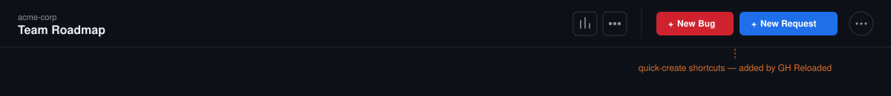
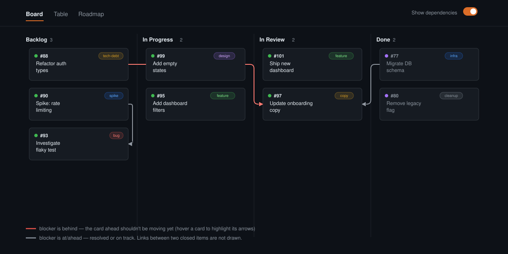
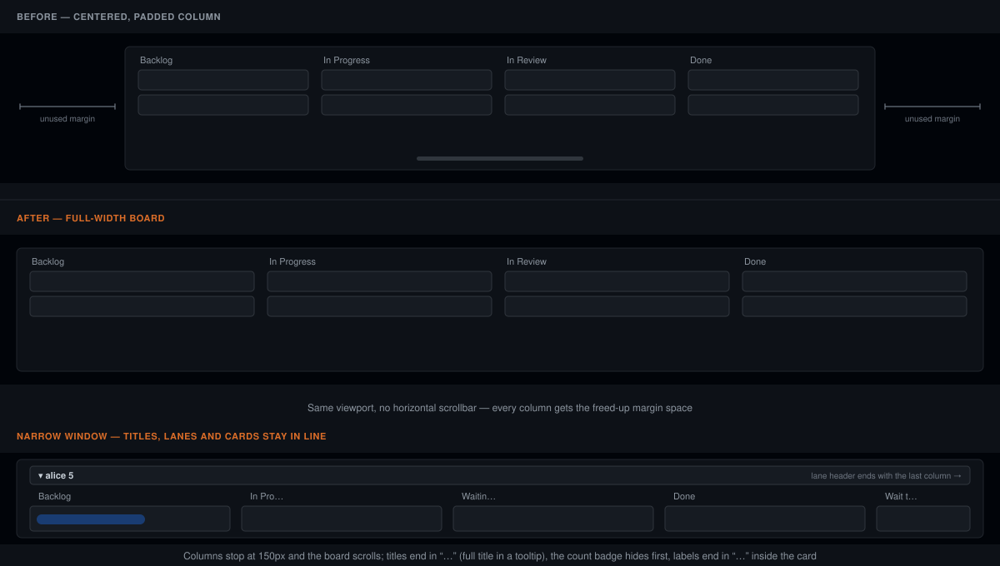
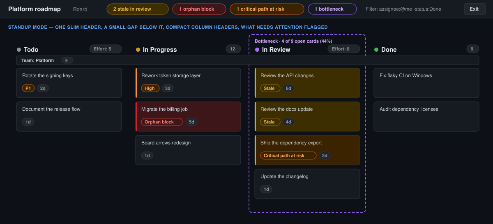
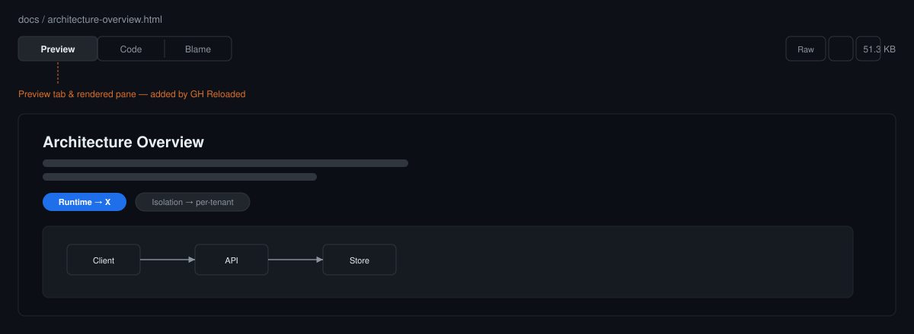
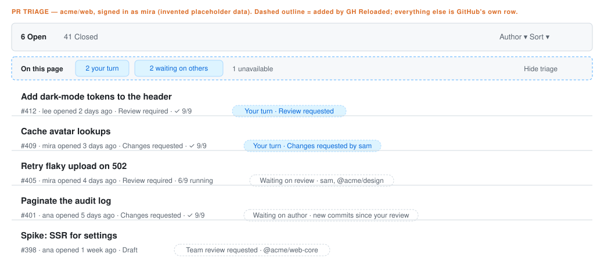
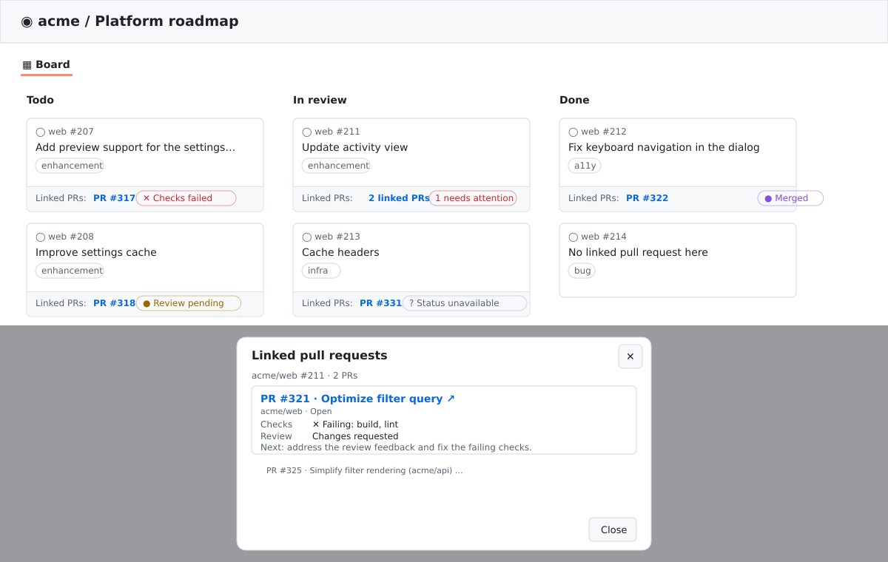
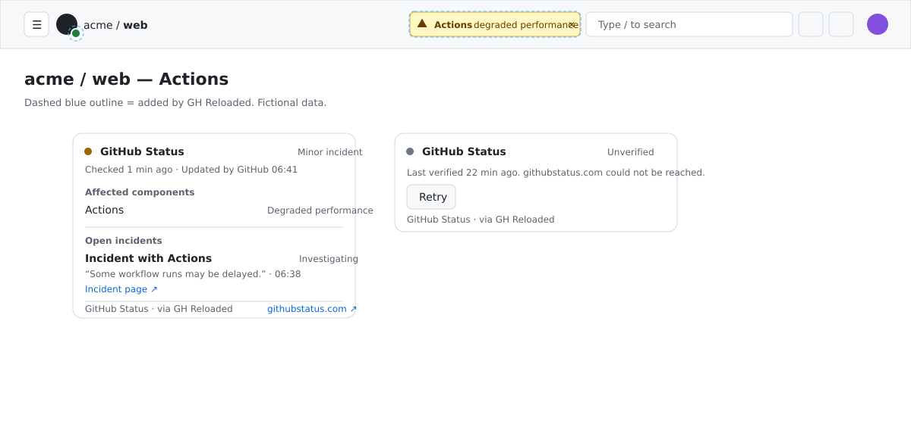

<p align="center">
  
</p>

<h1 align="center">GH Reloaded</h1>

<p align="center">
  <a href="https://gh-reloaded.simone3-cattani.chatgpt.site/">Website</a> ·
  <a href="LICENSE">License</a> ·
  <a href="CONTRIBUTING.md">Contributing</a>
</p>

<p align="center">
  <a href="LICENSE"></a>
  
  
  <a href="CONTRIBUTING.md"></a>
</p>

<p align="center">
A Chrome extension that injects small, focused UI enhancements into github.com, aimed at making GitHub itself more pleasant to use.
</p>

It's a collection of independent features, not a single-purpose tool: each one lives in its own folder under `features/` and can be added, removed, or shipped on its own. GitHub covers the fundamentals well; this is for the gaps that are easier to fill from the outside than to wait on.

## Install

Install **GH Reloaded** from the [Chrome Web Store](https://chromewebstore.google.com/detail/gh-reloaded/nflpdflhgpnhlahgajbgbpbblniggpba), then open **Settings**: click the extension's toolbar icon, or from `chrome://extensions` → the extension's card → **Details** → **Extension options**.

Most features work on public repositories without a token. A token adds private repositories, Projects v2 data and higher rate limits.

### Create a GitHub token

Pick one of two supported token types: **A** (recommended) for most setups, **B** when your Projects are owned by a personal account.

#### A. Fine-grained token (recommended)

Go to [github.com/settings/personal-access-tokens/new](https://github.com/settings/personal-access-tokens/new) and set:

- **Resource owner** → the account or organization that owns the repositories (a token has exactly one resource owner).
- **Repository access** → *Only select repositories* → pick the repo(s) you want this on.
- **Permissions**, all **Read-only**, everything else stays at *No access*:

| Scope | Permission | Used for |
| --- | --- | --- |
| Repository | **Issues** | sub-issues, dependencies, org-level custom fields (Team / Business Value / Effort), My Issues |
| Repository | **Pull requests** (and **Commit statuses** or **Checks** for the checks rollup) | PR triage, Linked PR status |
| Repository | **Contents** | **HTML preview** of files in private repos (public repos work without a token) |
| Repository | **Metadata** | added by GitHub automatically |
| Organization | **Projects** | Projects v2 Status, Standup mode, My Issues project memberships |

Click **Generate token** and copy it immediately — GitHub shows it exactly once.

Two GitHub limitations to know about:

- **Organization** permissions only appear when the resource owner is an organization. A fine-grained token cannot read Projects owned by a personal account: for those, use a classic token (B). Without it the features that depend on them degrade (no Status, Standup signals or project memberships) while the rest keeps working.
- A fine-grained token has one resource owner, so work across several owners (organizations or personal accounts) needs one token per owner, see [Connect it](#connect-it).

If the organization requires approval for fine-grained tokens, the token you create may show as *pending* until an organization owner approves it, and requests to that organization's data can come back empty or `404` until then, since GitHub doesn't otherwise reveal that the resource exists. If the organization has disabled fine-grained personal access tokens altogether, it does not appear in the **Resource owner** list and you cannot create a token for it: ask an organization owner to allow fine-grained tokens, or use a classic token.

#### B. Classic token (Projects owned by a personal account)

Use this when the Projects you want to read belong to your personal account, which fine-grained tokens cannot read. Go to [github.com/settings/tokens/new?scopes=read:project,public_repo&description=GH%20Reloaded](https://github.com/settings/tokens/new?scopes=read:project,public_repo&description=GH%20Reloaded) and tick:

- `read:project` — read access to Projects v2.
- `public_repo` — GitHub's GraphQL API requires it for the issue and status data the Projects features read. The extension only reads, but the scope itself is broad: GitHub defines it as read and write access to code, commit statuses, repository projects, collaborators and deployments of every public repository your account can reach.
- `repo` — instead of `public_repo`, only if you also need private repositories (issues, sub-issues, dependencies, HTML preview). Tick it yourself on the same page: it is broad, it also grants write access to every repository your account can reach.

The extension only reads, but a leaked classic token could do more than a fine-grained one, so prefer A whenever it covers your setup, and leave `repo` off unless you need private data. One classic token covers every owner you can reach, so you do not need one per owner.

If an organization enforces SSO, open [github.com/settings/tokens](https://github.com/settings/tokens) and use **Configure SSO** next to the token to authorize it for that organization; otherwise GitHub answers with empty results or `404`.

### Connect it

Back in the extension's Settings page, under **GitHub tokens**: paste the token (`github_pat_…` or `ghp_…`) into **Default token**, **Save tokens**, then **Test** — it should report the GitHub username the token authenticates as.

**Verify access.** **Test** only proves the token authenticates. **Verify access**, next to it on every token card, opens a panel where you name a repository (required) and optionally an issue, a Projects v2 URL and a private file, then **Run checks** sends at most four read-only requests with that card's own token (an unsaved token is used as typed and labelled). Each capability is reported as *Available*, *Access denied* (only when GitHub's answer proves it: an invalid token, SSO not authorized, a missing permission or an organization policy), *Not verified* (a 403 or 404 that could have several causes, so no permission is blamed), *Not checked* (nothing to test) or *Temporary error* (rate limit, network, timeout). Nothing runs on page load, and results are never stored or shown with the token. A Projects URL under `/users/<login>/projects/<n>` is owned by a personal account: a fine-grained token cannot read it, so any result other than *Available* points to a classic token with the `read:project` scope. See the screenshots for [light](screenshots/token-access-diagnostics/light.svg) and [dark](screenshots/token-access-diagnostics/dark.svg).

Working across several repository owners — organizations or personal accounts — that need their own token? **Add owner token** for each, with that owner's login (e.g. `acme`; a pasted `https://github.com/acme` works too). A request always uses the token of the repository's owner, falling back to the default token — never by trying every saved token in turn; with no default set, owners without a token of their own are read anonymously. Saved tokens are never shown again in full, only by their last 4 characters.

### Install unpacked (development and manual testing)

To run the code from this repository instead of the Store version:

1. Clone this repo.
2. Open `chrome://extensions`, enable **Developer mode** (top-right toggle).
3. Click **Load unpacked** → select the repo folder.
4. Open **Settings** as above and connect a token.


## Features

_Screenshots below are mockups illustrating each feature's layout and colors (matched to the extension's actual dark-theme CSS) — not literal captures of a live GitHub page._

### Dependency graph — [features/dependency-graph](features/dependency-graph)

On a GitHub issue page (or a Projects board's issue-preview side panel) that has sub-issues, injects a left-to-right dependency graph below the sub-issues list.


- Fetches the issue's direct sub-issues, their "blocked by" / "blocking" relationships, Projects v2 Status, and the org-level Team / Business Value / Effort custom fields (when available).
- Lays the graph out left → right with the cards ordered to minimise crossings, long edges routed between the cards instead of through them, a straight critical path and stable positions across refreshes (a cycle in the data is drawn as a dotted back edge), colored by each card's real board status, with dependencies outside the sub-issue set shown as dimmed, dashed "external" nodes on a plain surface (their Status shows in the border and dot, not as a tinted fill).
- Highlights the critical path (longest chain by total Effort — unestimated stories are assumed to cost the median of whatever else in the feature is sized, so a couple of missing estimates don't distort it) and lets you toggle how much of that external context to show, how columns are aligned, and whether to hide transitive dependencies (edges already implied by a longer chain, at any depth — hidden by default, uncheck to see every explicit dependency). Click a card (or focus it with Tab and press Enter or Space) to fade everything except its upstream and downstream (click it again, click the background or press Escape to clear).
- A full-screen control opens the same graph viewport-sized, with larger cards (showing Status and Team as well as the color fill), a header with the graphed issue's title and metadata (Status, Business Value, Effort, Team), and more room for long chains; close it with its button or Escape, without reloading the page or losing the current view.
- A refresh control rebuilds the graph in the background — and does so periodically on its own (about once a minute), so adding a sub-issue or a dependency shows up without reloading the page; returning to a tab refreshes it right away. The current graph stays visible until the new one is ready, a failed refresh keeps the last graph with a retry button, and automatic refreshing pauses while the tab is hidden and backs off when a refresh fails (hardest when GitHub signals a rate limit) so steady-state polling stays within GitHub's API quota.

### Quick-create button — [features/quick-create](features/quick-create)

A small floating button (or stack of buttons) on a GitHub Projects board view, each linking straight to "new issue" for a repo you configure in Settings — handy when the repo you actually file work into isn't the one the board itself lives in. Fully user-defined (label, URL, color, and an optional "only on this board" project match); nothing is preset.



### Board dependency arrows — [features/board-dependencies](features/board-dependencies)

On a GitHub Projects **Board** (kanban) view, draws an arrow directly between any two currently-visible cards where one blocks the other — red if the blocker is behind the card it blocks, gray otherwise — no need to open either issue to see the dependency. Arrows run in the gutters beside the cards and pass behind the cards they cross instead of through their text, a link between two closed (or merged) items is not drawn, and hovering or focusing a card highlights its arrows and fades the rest. Off by default; an icon button in the filter row, just left of GitHub's **View** button (shown only while a Board view is selected), turns it on, and the choice is remembered (also switchable from Settings).



### Full-width board — [features/full-width-board](features/full-width-board)

On a GitHub Projects **Board** (kanban) view, uses the full window width and makes every column flexible: columns grow into spare space, then shrink as needed (down to 150px each) so more of the board stays visible before horizontal scrolling is necessary. Boards with too many columns to fit at that minimum still scroll. On narrow windows column titles stay on one line with a tooltip (the count badge gives way first), cards keep their content inside the border, swimlane headers end with the last column, and the board lines up with the filter bar. On by default; switchable from Settings.



### Standup mode — [features/standup-mode](features/standup-mode)

On a GitHub Projects **Board** (kanban) view, adds a **Standup** button to the filter row, left of the dependency-arrows button and GitHub's **View** button, that turns the board into a compact presentation of the whole board. It reclaims the space GitHub's chrome uses (a slim bar is the only header: GitHub's title row, the view tabs, the filter bar and the View and other editing controls are hidden, the active filter is shown in the bar as read-only text, each column header shrinks to one row with a single metric pill, the columns fit the window width, and on a board grouped by a field the lane bands stay pinned right under the compact column headers instead of floating over the cards) and points at what needs attention, with a one-line summary at the top (for example "2 stale in review · 1 orphan block") whose entries jump to the cards:

- **Stale in review** — a card sitting in a review/QA/deploy-like column for longer than a threshold (default 3 days; the column is matched by its visible name, default keywords `review`, `qa`, `test`, `deploy`, `release`).
- **Orphan block** — a card marked blocked (a `blocked` label or a column named Blocked) that has no open blocker left and no comment explaining it.
- **Critical path at risk** — a card on the board's effort-weighted critical path that is past its target date or is held by an open blocker that has been sitting longer than the threshold.
- **Bottleneck** — a column holding a disproportionate share of the open cards, or whose oldest card is far older than the rest, is outlined.
- **Priority and age** — each card shows its Priority as a chip (high and critical priorities tint the card) and how long it has been in its current column (read from whichever Project field the board uses for its columns, not only Status).

The stale threshold and the review-like keywords are set in Settings → Advanced → Standup mode. The signals read Projects v2 data through the GitHub API, so they need a token with the read access listed under [Install](#install); without one (or without Projects access) the board still gets the space reclaim, a priority chip and a "Blocked" label read from the card, and the API-backed badges are simply absent. The bar says which of these happened: only a refusal from GitHub (HTTP 401/403, or a "Resource not accessible" error) is reported as a token that may lack Projects access; any other failure shows "Board signals could not be loaded" with the detail in the tooltip and the browser console, and a board that is still rendering shows the loading note. When GitHub returns an error for only some of the cards (an archived or inaccessible repository, say), the rest of the board still gets its signals and the bar says some cards could not be read. Draft items have no issue to look up, so they only get those card-read signals and count toward the column shares. The signals are re-read about every 75 seconds while the tab is visible, so edits made in place show up; if some cards cannot be read (for example a token without access to one owner, or a project whose fields that token cannot see), or some dependencies cannot be verified, the bar says so and the bottleneck and critical-path signals (or just the critical path, for dependencies) are turned off rather than computed from partial data. When a project and an issue belong to different owners, each is read with its own owner's token. On a board that uses Group by, columns are positioned by their heading across all horizontal sections. Exit with the **Exit** button or `Esc`. It's read-only and local to the tab — it never mutates issues, Project fields, or card order, and doesn't survive a reload. On by default; switchable from Settings.



### HTML preview — [features/html-preview](features/html-preview) — _Experimental_

Renders `.html`/`.htm` files instead of leaving them as plain source.

- On a pull request's **Files changed** tab, adds a globe button next to each HTML file's "..." menu that opens the rendered file in a new tab.
- On a file's own page, adds a **Preview** tab next to Code/Blame that renders it inline — the same way GitHub already does for Markdown. The Preview tab also stays on the Blame page (as a link back to the preview), so the three options are always there.
- The controls show up without reloading the page: after a full load, after GitHub's in-page navigation from any other page, and while a diff is still rendering progressively. If GitHub re-renders the page and drops them, they are put back.



Fetches the file's content through the GitHub API at the exact commit/branch shown (working out the right split itself even when a branch name contains a slash, e.g. `feature/x`), then renders it through two nested, sandboxed layers: an extension page with its own CSP, itself embedding a manifest-declared *sandbox page* whose separate, permissive-by-default CSP is where the previewed file's HTML actually lands. That inner page can run scripts and load resources the way a normal webpage would (inline `<script>`, CDN'd libraries, fonts, images) while still having no access to your GitHub session, cookies, or any extension API — that isolation, not CSP strictness, is what keeps it safe. Works without a token for public repos; a token with **Contents: Read-only** is needed for private ones. On by default.

Marked experimental: it renders arbitrary third-party HTML/JS, and the inline Preview tab anchors on GitHub's own (undocumented, redesign-prone) blob-page markup to inject itself — expect it to need upkeep as GitHub's UI changes.

### My Issues by project — [features/my-issues](features/my-issues)

On GitHub's own **My Issues** dashboard (`github.com/issues`), adds a `List | Group by project` switch next to the native flat list. Switched on, it reorganizes the same issues as a responsive grid of **Project tiles** (one to three columns, a column being added only while every issue title keeps room to read), each listing its issues by that Project's real Status — so work spread across several Projects is readable at a glance; switched off, GitHub's own list is restored untouched. On by default (the switch appears, the native list stays selected until you pick the grouped view). Settings → Advanced lets you set a minimum and a maximum tile width (280–2000 px; the default minimum is 630 px, no maximum), with a **Reset to defaults** button.


- Runs the dashboard's **current search** through the API and groups the **complete, paginated** result set — not just the rows the dashboard happens to have rendered. It follows both the search box (and any filter or saved view) and the dashboard's own **Assigned / Created / Mentioned** tab, so the groups always match whatever the native page is showing. Changing any of them updates the groups to match.
- Each **tile** is collapsible and shows the Project name (a link), an issue count, an "Open project ↗" link and a **distribution bar** with a text legend (`20 Open · 3 In Progress`) colored with the Project's own Status colors. A collapsed tile keeps its header, bar and legend, so **Collapse all** doubles as an overview.
- Inside a tile, issues are listed per Status in the Project's **real option order** — no invented global columns, no special handling of any Status name. The first **5** issues of each Status are shown, then a **Show N more** button expands the rest in place. A row is `state icon · title · issue type · #number · time since update`, most recently updated first. The number sits in a small gray chip whose tooltip carries the full `owner/repo#number`; the repo name joins the chip (`repo#number`) only when two issues of the same tile share a number from different repos. The **issue type** (an organization feature) shows as a chip tinted with the type's own color, collapsing to a colored dot in a narrow tile, and is simply absent for issues without a type or when GitHub does not offer the field.
- An issue in several Projects shows in each tile with the status it has **in that Project**, and is counted once in the toolbar summary (`34 issues in 3 projects`). One assigned to none falls into an explicit **No Project** tile, and one in a Project with no status into **No Status**.
- A **collapsible sidebar**: the dashboard's left sidebar (Assigned to me, Created by me, Mentioning me, Recently updated, Views) collapses to a 48px icon rail (centered icons, a highlighted active item, the toggle at its top), collapsed by default, in List and grouped view alike; the choice is remembered. It is found by the visible text of its navigation items; if they can't be found, no toggle is added and the page is left untouched.
- Read-only: it only links out to issues, and never changes an issue or a Project item. Needs a token with the read access listed under [Install](#install) to see project memberships; without it, issues still list under "No Project". Loading, empty, missing-token, and API-error states are shown explicitly, and a result set larger than the fetch cap is labelled "Showing the first N of M issues" rather than presented as complete.

### PR triage — [features/pr-triage](features/pr-triage)

On a repository's own **Pull requests** page (`github.com/<owner>/<repo>/pulls`), a compact **My PR triage** panel sits above the search box and groups the open PRs on the current page into **Needs my action** and **Waiting on others**. Each entry links to the PR and shows its number and the specific reason ("Review requested", "Changes requested by sam", "Waiting on author"). The header counts both groups, plus team requests and PRs that could not be read; five entries per group are shown, with **Show more / Show fewer** for the rest of the loaded rows. **Collapse panel** keeps the header and counts visible. The one-label-per-row context stays in the native list below. Search, filters, sorting, pagination, order and actions are untouched. On by default; **Hide triage** on the page, or the switch in Settings → Features, removes panel and labels through the existing saved preference. Collapse and expanded groups are temporary: they survive filter and page changes in the same repository and reset in another repository or after a reload.



- A PR gets at most one placement, the **author role first**. As author: `Your turn` when a reviewer's latest review requests changes and they were not asked again, when the checks fail, or when the branch conflicts; `Waiting on review` (naming reviewers and teams) or `Waiting on checks` otherwise. As reviewer: `Your turn · Review requested` when you are asked (also after your own earlier "changes requested"); `Waiting on author` after you requested changes, with a note when there are new commits since (commits alone never make it your turn). A team request alone shows a neutral `Team review requested` (membership is not checked and it is counted in neither group). Approved, green, or a draft with no blocker: no placement. There is no "ready to merge" and no unread status, ever.
- Review facts come from one batched GraphQL query per page of visible PR numbers (25 per query, two in flight, cached for 60 seconds), with the token mapped to the repository owner or the default one. The native list never waits for it: the panel says `Loading review data…` first. Without a token, with a refusal or a rate limit, the panel says what is missing and the rows get no guessed label; a single PR that cannot be read says `Triage unavailable`. Needs a token with **Pull requests: Read** (and read access to commit statuses or checks for the checks rollup).
- Only open and draft rows of the repository's list are triaged; the closed and merged tabs and the global `github.com/pulls` page are left alone. Rows are found through `data-testid` hooks and ARIA labels, never CSS-module classes; if an anchor (the page's `Pull requests` search landmark for the panel) is missing, nothing is rendered until the next scan.

### Linked PR status — [features/linked-pr-status](features/linked-pr-status)

On a Projects **Board** view, an issue card with at least one pull request explicitly linked to it (the issue's Development links, whether added by hand or by a closing keyword) gets a one-line muted band at the bottom of the card, under its fields and a thin divider, inside the card's outline, that starts with the label `Linked PRs:` (`PRs:` on narrow cards) followed by `PR #317` and one text signal. The signal is the first that applies of `Changes requested`, `Checks failed`, `Review pending`, `Checks pending`, `Approved`; draft, merged and closed PRs are neutral, and a PR whose data cannot be read says `Status unavailable`, never green. Several linked PRs show the count on the left (`2 linked PRs`, `2 PRs` on narrow cards) and, on the right, an attention chip when some need it (`1 needs attention`); PRs whose status cannot be read are counted too, in a neutral chip with a `?` (`1 status unavailable`, `1 unavailable` on narrow cards). A caption at the end of the same line says why (`Review feedback blocks progress`, `Checks are failing`); it is cut with an ellipsis when the card is narrow, with the full text in its tooltip and in the modal. When the token can list the links but not read a PR's status, the card says so, a dismissible hint names the missing permission (Pull requests: Read, plus Commit statuses or Checks) and links to Settings, and the modal repeats it. Click, Enter or Space on the row opens a modal (Esc closes it) with an attention banner (a status summary, not a merge verdict), the issue title in its subtitle and one section per PR: checks and review as separate pills, the names of the failing checks, a plain next step and an Open PR button. Cards without a linked PR, PR items and draft items are untouched. On by default; the switch is in Settings → Features.



- Only explicit links count: nothing is inferred from titles, numbers or mentions. `Approved` describes the review only: there is no "ready to merge" anywhere, because branch rules may still block. State is always text plus a glyph, never colour alone.
- Cards are found through the un-hashed `.board-view-column-card` and the `Fields` list's ARIA label, never CSS-module classes; if an anchor or the issue link is missing nothing is added until the next scan. When a card already shows GitHub's own *Linked pull requests* field, the row keeps the signal and drops the PR number. Click and key events stop at the row, pointer events do not, so a card can still be dragged from it.
- Data comes from one aliased GraphQL query per 20 issues (two in flight), only for cards near the viewport, with the token mapped to the issue's owner or the default one, cached for 60 seconds in the service worker and 2 minutes on the page. Without a token, or with a token that is refused (it needs **Pull requests: Read**), nothing is shown and a small dismissible hint at the bottom left of the board says why and links to Settings (the dismissal of the token hints is remembered; a rate-limit hint is not and clears when the data loads). An open PR with no review or checks signal shows only its `PR #N` link, no chip. A PR in a repository the token cannot read is not returned by GitHub and cannot be shown. Needs **Pull requests: Read** (and read access to commit statuses or checks for the checks rollup). Nothing is ever written to Projects or PRs.

### GitHub Status — [features/github-status](features/github-status)

A small status badge on the corner of the GitHub logo on every github.com page, like a presence dot on an avatar, ringed in the header's own colour: green when [githubstatus.com](https://www.githubstatus.com/) reports no incident, amber for a minor incident or a maintenance in progress, red for a major or critical one, and a gray dot when the status is unknown or older than 15 minutes. Click it (or press Enter or Space) for a panel with the overall status, only the affected components, the open incidents with their latest update, "Checked N min ago", the attribution "GitHub Status · via GH Reloaded" and a link to githubstatus.com. When an open incident concerns the page you are on (an Actions incident on Actions pages, a Pull Requests one on pull requests, and so on) or has wide impact, a pill with the component and its state appears in the header bar, before the search box, with a 2px severity line on the header's bottom edge; **✕** dismisses it until that incident gets a new update, and the panel still lists it. Other incidents only tint the dot. "No incident reported" is never a guarantee that everything works. On by default; the switch is in Settings → Features and **Show incident notice** in Settings → Advanced → GitHub Status.



- Data comes only from the official Status API: one anonymous `summary.json` request, made by the extension's service worker and shared by all tabs (cached in memory for 5 minutes, one request at a time, 10 second timeout, backoff after a failure). Nothing about you, the page or your repositories is sent, and no token is used. An unreachable or unexpected response shows the gray "Unverified" state, never a stale green. No new permission: the Status API allows cross-origin reads.
- The badge is overlaid on the logo link's bottom-right corner with CSS anchor positioning (Chrome 125 and later; older versions keep a plain dot beside the logo) and takes no room in the header, and the pill right before the header's search control, found by their accessible names and icons, never CSS-module classes; if an anchor is missing nothing is inserted until the next scan.

More features will land as their own entries here, each in its own folder under `features/` (and `background/` for anything they need server-side). See [Contributing](#contributing) for the shape a new one takes.

## Known limitations

- **GitHub's markup changes.** The extension injects into github.com's own pages and anchors on visible text, roles and ARIA attributes rather than class names, but a GitHub redesign can still hide a control until the extension is updated. When an anchor is not found, the feature shows nothing instead of a broken layout.
- **Personal-account Projects need a classic token.** Fine-grained tokens cannot read Projects v2 owned by a personal account; see [Create a GitHub token](#create-a-github-token).
- **One fine-grained token per owner.** Work across several organizations or accounts needs one token per resource owner.
- **Organizations may restrict tokens.** Approval requirements, SSO authorization or disabled fine-grained tokens make requests come back empty or `404`; **Verify access** in Settings tells which capability is affected.
- **Rate limits.** Without a token, GitHub's anonymous rate limit applies and data may show a temporary error.
- **HTML preview is experimental** and runs the file's own scripts in an isolated sandbox page with no access to your GitHub session.
- **Chrome only.** It is a Manifest V3 extension for Chrome and Chromium browsers; the page may need a reload after installing or updating the extension.

## Troubleshooting

- **A feature does not appear.** Check it is switched on under **Settings → Features**, then reload the GitHub tab. After an extension update, reload open GitHub tabs too.
- **"Missing token" or empty data.** Add a token under **GitHub tokens** and run **Test**; private repositories and Projects need one.
- **Data for one organization is missing.** Add an owner token for that owner, authorize it for SSO if required, then run **Verify access** on its card.
- **No Status, Standup signals or project memberships.** The token lacks Projects access: use the organization **Projects** permission, or a classic token with `read:project` for personal-account Projects.
- **A page GitHub redesigned.** The feature stays hidden rather than breaking the page; please open an issue with the page URL.

## Project layout

```
manifest.json                       MV3 manifest — wires content scripts and the background service worker
background.js                       Service worker entry point: opens Settings, routes messages to feature modules
lib/github-api.js                   Shared GitHub REST/GraphQL client (auth, caching) used by every feature
background/<feature>.js             One feature's server-side logic (GitHub calls, computation) + its MESSAGE_TYPE
features/<feature>/                 One feature's content-script side: DOM injection, rendering, styling
options/                             Settings page (feature toggles, GitHub tokens, quick-create shortcuts, advanced tuning)
icons/                               Toolbar/extensions-page icons
```

## Releasing

Versioning and releases are automated with [Release Please](https://github.com/googleapis/release-please), driven by [`.github/workflows/release.yml`](.github/workflows/release.yml). Regular pull requests never touch `manifest.json`'s `"version"`; a bot owns the version number, which is a release decision rather than something each change picks.

The flow:

1. PR titles are [Conventional Commits](https://www.conventionalcommits.org/) (`feat:`, `fix:`, `docs:`, …), enforced on every PR by [`.github/workflows/pr-title.yml`](.github/workflows/pr-title.yml). PRs are squash-merged with the commit messages as the body (a single-commit PR takes its commit subject as the title, so keep it equal to the PR title), so each PR becomes one conventional commit on `main`.
2. On each push to `main`, Release Please reads those commits and keeps a single **release PR** open that bumps `manifest.json` and `.release-please-manifest.json` and updates `CHANGELOG.md`. A `feat` bumps the minor version, a `fix` or `perf` the patch version, and a breaking change (`!`) the major version, or the minor while below 1.0. Other types (`refactor`, `test`, `docs`, `ci`, `chore`, `build`, `style`, `revert`) make no release on their own. See [Picking the PR type](AGENTS.md#picking-the-pr-type).
3. Merging that release PR creates the `vX.Y.Z` tag and the GitHub Release, then the publish job packages the extension, uploads it to the Chrome Web Store (if the store secrets below are configured), and attaches `gh-reloaded-<version>.zip` to the release.

The zip bundles `manifest.json`, `background.js`, `background/`, `features/`, `icons/`, `lib/`, and `options/` — the same explicit path list as before, so the test harness and `docs/` do not ship.

### Requesting a milestone version

To jump to a specific version (for example the first stable `1.0.0`), end the last commit message of a pull request with a `Release-As: 1.0.0` footer and keep that line when squash-merging. Release Please reads footers only from the last block of the message, and GitHub appends `---------` and `Co-authored-by:` lines after the commit messages: delete them in the merge dialog so `Release-As: 1.0.0` is the last line. Release Please then rewrites its open release PR to that version. The footer only counts for the commits since the last release, so nothing has to be removed afterwards and normal SemVer resumes. Never fake a `feat!:` to force a major version. The human release announcement for a milestone lives in [`docs/releases/`](docs/releases), ready to paste above the generated notes; `CHANGELOG.md` stays generated. The checks made on the 1.0.0 candidate and what stayed open are recorded in [`docs/releases/1.0.0-verification.md`](docs/releases/1.0.0-verification.md).

### Repository settings (one-time, admin)

Release Please needs two repo settings that a workflow file can't set itself:

- **Settings → General → Pull Requests**: allow only **squash merging**, with the default commit message set to **Default to pull request title and commit details**, so the commit messages (and a `Release-As:` footer) reach `main`.
- **Settings → Actions → General → Workflow permissions**: enable **Allow GitHub Actions to create and approve pull requests** — without it the bot can't open the release PR.
- **Settings → Branches → branch protection for `main`**: if a `Require Version Bump / check-version` required status check was added under the old manual-bump flow, remove it. This PR deletes that workflow, so the check can never report again and would otherwise block every PR — including the bot's release PR — forever.

The release PR is opened by `github-actions[bot]` with the built-in `GITHUB_TOKEN`. By GitHub's design, PRs and tags created with that token don't trigger other workflows, so CI doesn't run on the release PR; that's fine while no checks are required on `main`. If required checks are added later, switch Release Please to a repository-owned GitHub App token (see the issue's "Later ideas").

### One-time store setup

The API can only update an *existing* Chrome Web Store listing — the first submission has to happen by hand:

1. Pay the one-time $5 registration fee and create a [Chrome Web Store Developer Dashboard](https://chrome.google.com/webstore/devconsole) account.
2. Package the extension (`zip -r extension.zip manifest.json background.js background features icons lib options`), upload it as a new item, fill in the store listing (description, screenshots, privacy practices, single purpose, permission justifications), and submit it for review.
3. Once it's accepted, note the **Extension ID** (from the dashboard item URL) and your **Publisher ID** (Dashboard → account settings → *Publisher (developer) account*).
4. In Google Cloud Console, create an OAuth client (APIs & Services → Credentials → *OAuth client ID*; the refresh-token helper redirects to a random local port, so a "Web application" client needs that `http://127.0.0.1:<port>` redirect URI added first, while a "Desktop app" client accepts it as is) and enable the **Chrome Web Store API** on that project.
5. Generate a refresh token for that client, authorized for the `https://www.googleapis.com/auth/chromewebstore` scope against your Web Store account — e.g. via [`chrome-webstore-upload-cli`](https://github.com/fregante/chrome-webstore-upload-cli)'s docs, or any OAuth 2.0 installed-app flow.
6. Create an environment named `chrome-web-store` (repo Settings → Environments), restrict its deployment branches to `main`, and add these as **environment secrets** — not repository secrets, so that a workflow run from any other branch cannot read them:

   | Secret | Value |
   |---|---|
   | `CHROME_EXTENSION_ID` | Extension ID from step 3 |
   | `CHROME_PUBLISHER_ID` | Publisher ID from step 3 |
   | `CHROME_CLIENT_ID` | OAuth client ID from step 4 |
   | `CHROME_CLIENT_SECRET` | OAuth client secret from step 4 |
   | `CHROME_REFRESH_TOKEN` | Refresh token from step 5 |

The refresh token expires after 7 days while the Google OAuth app is in "Testing" status: publish the app (Google Auth Platform → Audience → *Publish app*) so it does not. To recover a failed publish, run the **Release** workflow manually with the tag to publish (e.g. `v0.7.0`).

Until all five secrets are set, the workflow still cuts a GitHub Release on every version bump; it just skips the store upload step (with a warning in the run log) rather than failing the run.

Google's own review queue still sits on top of this either way — a workflow run "publishing" a release means it was *submitted*, not that it's instantly live on the store.

## Contributing

Start with [CONTRIBUTING.md](CONTRIBUTING.md). The full conventions — the shape of a feature, the design rules, how docs stay in sync, the definition of done, and the git/PR workflow — live in [AGENTS.md](AGENTS.md), which both people and coding assistants read. Issues and PRs welcome.

## Privacy

See [PRIVACY.md](PRIVACY.md) — short version: nothing is collected, sold, or sent anywhere except directly to `api.github.com` with your own token.

## License

[MIT](LICENSE)
